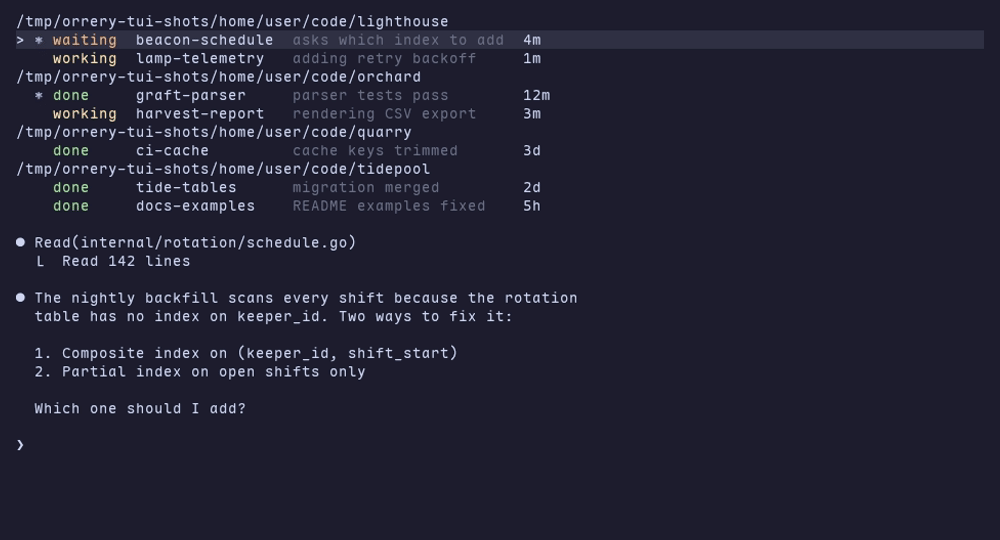
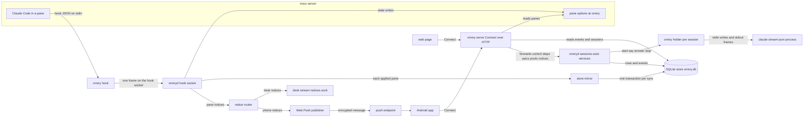

# orrery

orrery shows the state of every Claude Code session you run in tmux. It is for
people who keep several sessions open at once and do not want to visit each pane
to learn which one is working, which one waits for an answer, and which one has
finished.



A Claude Code hook reports each session's state to a local daemon, `orreryd`. The
daemon writes the state into the pane's tmux options, and `orrery tree` and
`orrery list` read it back. A pane that waits or finishes raises a notice, and the
daemon routes the notice to your desk or to your phone. With `--sessions`,
`orreryd` also runs headless Claude Code sessions, epics and steps, which the web
page and the phone can drive.

## Architecture

orrery is built as two binaries from this tree. `orrery` is the Claude Code hook
and the command-line client. `orreryd` is the daemon: it applies hook frames to
tmux, mirrors pane state into a SQLite store, and routes notices. `orreryd`
listens on unix sockets only, apart from the loopback listener that
`--metrics-listen` adds. `orrery serve` reads the store and forwards control calls
to `orreryd`, and the web page and the Android app reach it over Connect.



Arrows point the way data moves. The daemon is the store's only writer, so
`orrery serve` reads the store and never writes it. The diagram leaves out the
epic engine and the CLI; [docs/architecture.md](docs/architecture.md) has the full
component diagram, the sequence of one turn, and the data model.

## Quick start

Run the commands below from the root of a clone of this repository, inside the
devenv shell (`devenv shell`; see [CONTRIBUTING.md](CONTRIBUTING.md#dev-shell)).
They use a private tmux server, a temporary state directory, and a stand-in for
`claude`, so they do not touch your own tmux or a running `orreryd`. `--claude true`
makes sure the daemon can never start Claude. The demo hook event carries no
transcript, so the daemon's summary attempt stops before it runs anything and logs a
`read transcript excerpt failed` warning; you can ignore it.

```sh
set -eu

d=$(mktemp -d)
export XDG_STATE_HOME="$d/state" XDG_RUNTIME_DIR="$d/run" ORRERY_SOCKET="$d/orreryd.sock"
# The hook sends nothing from an orrery-started session (ORRERY_SESSION) or from a summarizer (ORRERY_SUMMARIZER).
unset TMUX TMUX_PANE ORRERY_SESSION ORRERY_SUMMARIZER
mkdir -p "$d/bin" "$d/project" "$d/run"
chmod 700 "$d/run"

orreryd_pid=
stop() {
  if [ -n "$orreryd_pid" ]; then
    kill "$orreryd_pid" 2>/dev/null || true
    wait "$orreryd_pid" 2>/dev/null || true
  fi
  tmux -L orrery-quickstart kill-server 2>/dev/null || true
  rm -rf "$d"
}
trap stop EXIT

wait_until() {
  i=0
  until "$@"; do
    i=$((i + 1))
    if [ "$i" -ge 100 ]; then
      echo "timed out: $*" >&2
      return 1
    fi
    sleep 0.1
  done
}
pane_state_is() {
  orrery -L orrery-quickstart list --json | grep -q "\"state\":\"$1\""
}

go build -o "$d/bin/" ./cmd/orrery ./cmd/orreryd
export PATH="$d/bin:$PATH"

tmux -L orrery-quickstart -f /dev/null new-session -d -s demo -c "$d/project" sleep 600
pane=$(tmux -L orrery-quickstart display-message -p -t demo:0.0 '#{pane_id}')

orreryd -L orrery-quickstart --claude true &
orreryd_pid=$!
wait_until test -S "$ORRERY_SOCKET"

printf '%s\n' '{"hook_event_name":"UserPromptSubmit","session_id":"example-session","prompt":"example prompt"}' \
  | TMUX_PANE="$pane" orrery -L orrery-quickstart hook
wait_until pane_state_is working

orrery -L orrery-quickstart list --json
```

`orrery list --json` prints one object per pane. For the demo pane, `state` is
`working` and `session` is `demo`. The field list is in
[section 3 of docs/contract.md](docs/contract.md#3-orrery-list---json).

## Install

Add this repository's flake as an input named `orrery`, then turn the module on in
your home-manager configuration:

```nix
{
  imports = [ orrery.homeManagerModules.default ];

  programs.tmux.enable = true;

  programs.orrery = {
    enable = true;
    # remoteHost = "example-host";  # SSH host that `p` opens sessions on
    roots = [
      {
        path = "Work";
        depth = 2;
      }
    ];
  };
}
```

The module installs `orrery` and the `p` launcher, and it sources the tmux plugin
through `programs.tmux.extraConfig`, which is why tmux must be enabled. It does not
start `orreryd` and does not register hooks. Register `orrery hook` for the Claude
Code events yourself; the settings are in
[Claude Code hook settings](docs/contract.md#claude-code-hook-settings).

The module's options are `enable`, `package`, `remoteHost`, `roots` and `roles`.
`roots` lists directories relative to your home directory for the `p` picker, and
`roles` maps each role to the agent it runs under.
[section 11 of docs/contract.md](docs/contract.md#11-commands-and-configuration)
documents the files they write.

## Daily use

`orrery help` prints this card, with the live tmux prefix when a server is reachable. `orrery help --html` writes it as a static page.

```text
orrery daily use

p
  p             attach the most recently active session, then open the tree
  p .           the session for the current directory, else the picker to resume or start fresh
  p PATH        the session for directory PATH (one with / or ..), else the picker to resume or start fresh
  p WORD        a session named WORD, else the known directory named WORD (several: choose one), else the picker
  p new NAME    create project directory NAME and a session for it (--root DIR sets the parent)
  p WORDS...    open the picker with WORDS as the intent, over known directories and the roots' directories

tmux
  prefix Space  open the tree in a popup
  prefix s      open the shell popup for the current pane's directory

kitty
  kitty_mod+p   run p; nix-config's kitty binding, not set by orrery

tree
  j, down       move the cursor one row down
  k, up         move the cursor one row up
  n             move to the next unseen row after the cursor, wrapping around
  /             start filter input. Typed text sets the filter. Backspace deletes its last character, Enter keeps the filter, and Esc clears it
  enter         switch the client to the row's pane, mark the pane seen, and close the tree
  x             mark the row's pane seen; the tree stays open
  c             add a window running `claude` to the row's session, started in the row's directory; the tree stays open
  s             open the shell popup for the row's directory, and close the tree
  N             close the tree and run the picker for the row's directory; the picker's choice switches the client
  p             show the pools view: each member's state and holder, the waiters, and the holds; p again returns to the panes
  h             in the pools view, hold the member under the cursor, or free it when it is held
  X             close the row's pane after a y/N prompt, asking twice for a working Claude pane
  D             close every session of the row's project and its shell session after a prompt listing them
  ?             show every key
  esc, q        close the tree
```

The picker offers the directories orrery knows (live sessions', closed panes' in the archive, orreryd's engine sessions' and step workspaces', and the children of `$HOME/Personal`) and the directories under the roots declared in `programs.orrery.roots`. The roots file is documented in [section 11 of `docs/contract.md`](docs/contract.md#11-commands-and-configuration).

## Phone service and Android app

`orrery serve` exposes the pane list, pane screens and input over HTTP, along with
headless sessions, epics, pools and notices, so a phone can read and drive them. It
listens on a loopback address and sits behind a proxy such as `tailscale serve`,
which sets the login header that `--allow-login` checks. Each request also carries
the `X-Orrery-Client` header that the server requires. Notices reach the phone as
encrypted Web Push messages. [section 12 of docs/contract.md](docs/contract.md#12-http-api)
documents the routes, the guard headers, push registration and the Web Push payload.

The Android app lives under `android/`. It is a Kotlin and Jetpack Compose app that
shows the pane list and each pane, headless sessions with their conversations,
epics, pools and settings. The server address is a setting the app keeps, and push
uses UnifiedPush.


Only debug builds are produced. The tree has no release variant and no signing key
or keystore.

```sh
just android-test     # assemble the debug APK, then run Android lint and the JVM unit tests
just android-install  # build the debug APK and install it on the phone
```

Both recipes enter the Android dev shell themselves. `just android-install` needs
the phone paired and connected with adb first.
A fresh install starts with `$ORRERY_DEFAULT_SERVER` as its server address, given at
build time (`just android-install` passes it as the Gradle property
`orrery.defaultServer`). An install keeps an address saved in its settings whatever
the default; with neither, the app asks for the server.

## Build and check

The Go toolchain and the other tools come from the devenv shell (`devenv shell`).
[CONTRIBUTING.md](CONTRIBUTING.md) covers the dev shell, the `just` recipes, lint and
coverage, generated code, and test conventions. Running `just` with no argument
lists the recipes.

- `just check-changed` is the fast gate for work in progress. It runs the checks that your changes can affect.
- `just check` is the full gate. The pre-push hook and CI run it.
- `nix flake check` evaluates and checks the flake, and `nix build` builds the packages.

## Documentation

- [docs/architecture.md](docs/architecture.md) explains the processes, what they share, and how a session's state, a headless turn and an epic move between them.
- [CONTRIBUTING.md](CONTRIBUTING.md) covers the dev shell, the `just` targets, lint and coverage, generated code, and test conventions.
- [docs/contract.md](docs/contract.md) is the shared contract: wire formats, option values, file modes and exit codes. Its command lines are in [section 11](docs/contract.md#11-commands-and-configuration) and its HTTP API is in [section 12](docs/contract.md#12-http-api).
- [docs/engine-protocol.md](docs/engine-protocol.md) records what the Claude Code stream-json protocol does, as a live recording showed it.

## License

MIT. See [`LICENSE`](LICENSE).

The bundled Orrery Mono font files (`android/app/src/main/res/font/orrery_mono_*.ttf`) are a subset of Maple Mono NF and are licensed under the SIL Open Font License; see [`orrery_mono_ofl.txt`](android/app/src/main/res/raw/orrery_mono_ofl.txt).
