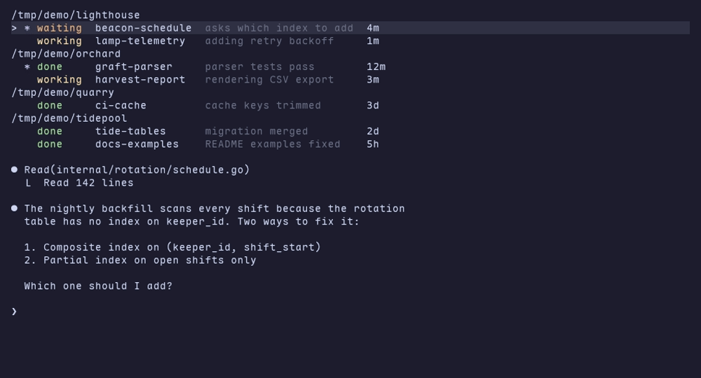

# orrery

orrery is a tmux-aware status board for Claude Code sessions.

A Claude Code hook run through `orrery` reports each session's state (working,
waiting, or done) to a local daemon, `orreryd`, over a Unix socket. The daemon
records that state in per-pane tmux options, summarizes it, and can notify you
through ntfy. `orrery list` shows the panes and their states.



## Binaries

- `cmd/orrery`: the Claude Code hook and the CLI client (`hook`, `list`, `seen`, `send`, `debug summarize`, `shell`, `tree`, `tmux-conf`, `open`, `help`).
- `cmd/orreryd`: the local daemon that holds session state and listens on a unix socket only.

## Usage

Register `orrery hook` for the Claude Code hook events in your settings, then
read the pane states with `orrery list --json`. `orrery tree` shows the panes
and `orrery open` attaches or starts a project session. The tmux plugin
(`orrery tmux-conf`) binds prefix `Space` to the tree and prefix `s` to a
directory shell, and the home-manager module (`programs.orrery`) installs
orrery and the `p` launcher. Command lines, flags, environment variables, exit
codes, key tables, and a settings example are documented in
[section 11 of `docs/contract.md`](docs/contract.md#11-commands-and-configuration).

## Daily use

`orrery help` prints this card, with the live tmux prefix when a server is reachable. `orrery help --html` writes it as a static page.

```text
orrery daily use

p
  p             attach the most recently active session, then open the tree
  p .           the session for the current directory, else the picker to resume or start fresh
  p WORD        a session named WORD, else a zoxide match, else the picker
  p new NAME    create project directory NAME and a session for it (--root DIR sets the parent)
  p WORDS...    open the picker with WORDS as the intent

tmux
  prefix Space  open the tree in a popup
  prefix s      open the shell popup for the current pane's directory

kitty
  kitty_mod+p   run p; nix-config's kitty binding, not set by orrery

tree
  j, down       move the cursor one row down
  k, up         move the cursor one row up
  n             move to the next unseen row after the cursor, wrapping around
  /             start filter input. Typed text sets the filter. Backspace deletes its last character, Enter keeps the filter, and Esc clears it
  enter         switch the client to the row's pane, mark the pane seen, and close the tree
  x             mark the row's pane seen; the tree stays open
  c             add a window running `claude` to the row's session, started in the row's directory; the tree stays open
  s             open the shell popup for the row's directory, and close the tree
  N             close the tree and run the picker for the row's directory; the picker's choice switches the client
  X             close the row's pane after a y/N prompt, asking twice for a working Claude pane
  D             close every session of the row's project and its shell session after a prompt listing them
  ?             show every key
  esc, q        close the tree
```

## Phone service

`orrery serve` exposes the pane list, pane screens, and input over HTTP, so a
phone client can read and drive the panes. It listens on a loopback address and
sits behind `tailscale serve`. The routes, guard headers, push registration, and
Web Push payload are documented in
[section 12 of `docs/contract.md`](docs/contract.md#12-http-api).

## Build and check

```sh
nix develop        # enter the devShell with the Go toolchain and just
just check         # lint and race tests, with the 80% coverage gate
nix flake check    # evaluate and check the flake
nix build          # build the packages
```

## Android

The Android app lives under `android/`. It is a Kotlin and Jetpack Compose
app. Only debug builds are produced; no signing key or keystore is in the tree.

```sh
nix develop .#android      # enter the android devShell with the SDK, Gradle, and JDK 17
just android-test          # run the Android lint and JVM unit tests
just android-install       # build the debug APK and install it on the phone
```

`just android-install` needs the phone paired and connected with adb first.
The server address setting defaults to `https://vermissian.tail82223.ts.net:8490`.

## Interface

The frozen interface between the hook, the CLI, and the daemon is documented in
[`docs/contract.md`](docs/contract.md).

## License

MIT. See [`LICENSE`](LICENSE).

The bundled Orrery Mono font files (`android/app/src/main/res/font/orrery_mono_*.ttf`) are a subset of Maple Mono NF and are licensed under the SIL Open Font License; see [`orrery_mono_ofl.txt`](android/app/src/main/res/raw/orrery_mono_ofl.txt).
