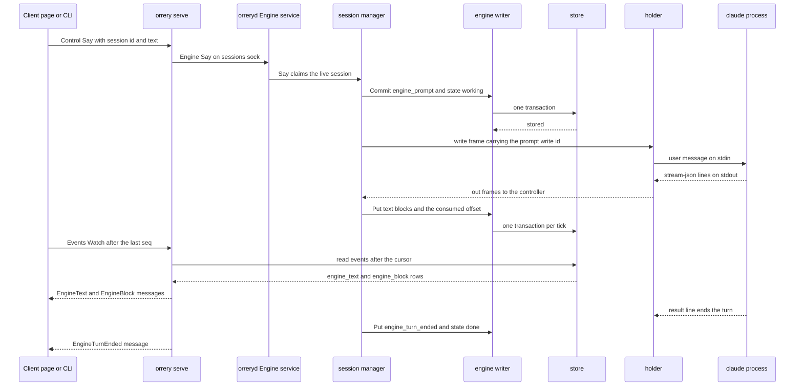
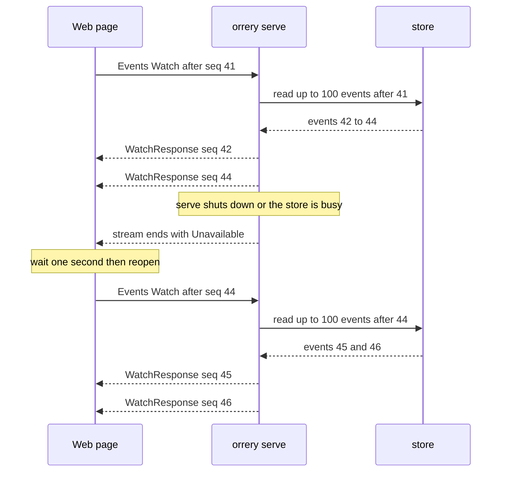

# orrery architecture

This document explains how orrery works in this tree: which processes run, what they share, and how a Claude Code session's state, a headless session's turn and an epic move between them. It is written for an engineer who reads the code next. Links name the Go, Kotlin or TypeScript symbol or package that carries each behaviour, and point at the file that defines it.

Wire formats, option values, file modes and exit codes live in [the shared contract](contract.md), which is the behaviour reference. This document points there instead of repeating it. [The engine protocol findings](engine-protocol.md) record what the Claude Code stream-json protocol does, as a recording showed it.

## What orrery is

orrery is built as two binaries from this tree:

- `orrery` ([`cmd/orrery`](../cmd/orrery/main.go)) is the client. Claude Code runs its `hook` subcommand for each hook event. People run its other subcommands, among them `tree`, `list`, `open`, `send`, `seen`, `session`, `run`, `gate`, `epic`, `serve`, `events`, `notices` and `desk`.
- `orreryd` ([`cmd/orreryd`](../cmd/orreryd/main.go)) is the daemon. It applies hook frames to tmux, mirrors pane state into a SQLite store, and routes notices to the desk and the phone. With `--sessions` it also runs headless Claude Code sessions, steps, epics, pools and evidence runs.

## Components

```mermaid
flowchart LR
  subgraph tmuxSrv ["tmux server"]
    pane["Claude Code in a pane"]
    opts["pane options at orrery"]
  end
  hook["orrery hook"]
  daemon["orreryd hook socket"]
  mirror["store mirror"]
  store[("SQLite store orrery.db")]
  sess["orreryd sessions.sock services"]
  holder["orrery holder per session"]
  child["claude stream-json process"]
  epic["epic engine planner build interpreter"]
  router["notice router"]
  desk["desk stream notices.sock"]
  pushes["Web Push publisher"]
  relay["push endpoint"]
  serve["orrery serve Connect over HTTP"]
  page["web page"]
  app["Android app"]
  cli["orrery events and orrery session"]

  pane -- "hook JSON on stdin" --> hook
  hook -- "one frame on the hook socket" --> daemon
  daemon -- "state writes" --> opts
  daemon -- "each applied pane" --> mirror
  mirror -- "one transaction per sync" --> store
  daemon -- "pane notices" --> router
  router -- "desk notices" --> desk
  router -- "phone notices" --> pushes
  pushes -- "encrypted message" --> relay
  relay --> app
  sess -- "start say answer stop" --> holder
  holder -- "stdin writes and stdout frames" --> child
  sess -- "rows and events" --> store
  epic -- "node runs and steps" --> sess
  epic -- "rows" --> store
  serve -- "reads events and sessions" --> store
  serve -- "reads panes" --> opts
  serve -- "forwards control steps epics contracts pools notices" --> sess
  page -- "Connect" --> serve
  app -- "Connect" --> serve
  cli -- "Connect" --> serve
```

Arrows point the way data moves. The store has one writer in the daemon. The serve process reads the store and never writes it, so every change to a session, an epic or a pool passes through `orreryd`. The phone and the web page both reach `orrery serve` over Connect, and `serve` runs on a loopback address behind a proxy.

## CLI and hook

Claude Code runs `orrery hook` for each hook event that the user's settings register (see [Claude Code hook settings](contract.md#claude-code-hook-settings)). [`hook.Run`](../internal/hook/hook.go) reads the event's JSON from stdin, adds the pane id, the tmux socket, the working directory and the session's `ANTHROPIC_BASE_URL`, and writes one frame to the daemon socket. It always exits 0 and prints nothing. Its write has a 20 ms deadline, so a slow or absent daemon never holds up Claude Code. It sends nothing for the summarizer's own `claude` process or for headless sessions that `orreryd` started, since the hook recognizes each by an environment marker.

[`state.ApplyWith`](../internal/state/state.go) maps each hook event to a pane state:

| Hook event | Pane state |
|---|---|
| `UserPromptSubmit`, `PreToolUse`, `PostToolUse`, `PostToolUseFailure` | `working` |
| `PermissionRequest`, and `Notification` for a permission prompt, an elicitation dialog or an agent that needs input | `waiting` |
| `Stop`, `StopFailure` | `done` |
| `SessionEnd` | unsets the state, changed, seen, question, summary, label, tool and turn-start options. The Claude session id and transcript stay, unless the reason is `clear`. |

A tool event that arrives within five seconds after a turn's `Stop` is a late frame. It leaves the pane `done`. The full rules, including what a `PermissionRequest` stores as the question, are in [Pane state](contract.md#1-pane-state) and [Per-pane tmux options](contract.md#2-per-pane-tmux-options).

Commands that read or change tmux go through [`tmuxctl.Client`](../internal/tmuxctl/tmuxctl.go). It runs the `tmux` binary with an argument vector and never through a shell, and `-L` or `-S` selects the server. `orrery mcp` serves the step, epic and evidence tools to a Claude session over MCP on stdin and stdout ([`stepmcp`](../internal/stepmcp/tools.go)).

## orreryd and the store

The [`orreryd` serve path](../cmd/orreryd/main.go) opens the push store and the notice log, then binds the daemon socket and the desk socket. It serves hook frames while the store opens, so no frame waits for the store. A pane sync that cannot get the store in time is deferred and drained later. Once the store is open and migrated, `orreryd` attaches it to the mirror, the notices and the router. With `--sessions` it then starts the session services on `sessions.sock`, which listens only after the store is open. Shutdown runs the same steps in reverse, and the desk closes last, after the notices that post to it.

The store is one SQLite file, `orrery.db`, opened in WAL mode with a 5-second busy timeout, the wait Litestream recommends for a database it replicates, since its checkpoints take the write lock ([`store.Open`](../internal/store/store.go), [`store.BusyTimeout`](../internal/store/store.go)). Its schema is the embedded goose migrations in `internal/store/migrations`, numbered `00001` through `00043`. [`store.ErrTooNew`](../internal/store/store.go) refuses a database that records a newer migration than the binary embeds, so an older binary never migrates a newer schema. The store has three kinds of reader and writer:

- The pane mirror. [`daemon.Mirror`](../internal/daemon/mirror.go) syncs each applied pane after its tmux writes, in one transaction, and mints the pane's `@orrery_id` when it has none. A tidy pass every ten seconds lists each tmux server it can read, syncs every pane it finds, and deletes the rows of panes that are gone. The tidy also prunes events older than 14 days, always keeping the newest.
- The engine writer. [`enginehost.Writer`](../internal/enginehost/writer.go) is the one goroutine that stores headless session ops. It stores every queued op each tick, in one call, so sessions never hold the store's locks.
- Readers. `orrery serve` opens the file read-only on each call through [`store.Reader`](../internal/store/reader.go) and holds no connection between calls. The CLI reads it read-only to find known directories for `orrery open`.

## tmux panes

A pane's state is stored in `@orrery_*` options on the pane, set with `set-option -p`. The one session-scoped option is `@orrery_dir`, which records a project session's directory. [Per-pane tmux options](contract.md#2-per-pane-tmux-options) lists each option, and the [data model](#data-model) below repeats the list with the store columns that mirror them. tmux owns the panes, so these options survive a daemon restart, and every reader (the tree, `orrery list`, `serve`) reads the same values from the server that owns the panes.

The pane tree, which `orrery tree` runs ([`tui.Run`](../internal/tui/tui.go)), groups panes by project and marks each with its state. Its keys are in [Tree keys](contract.md#tree-keys). `orrery open` finds a project's session through `@orrery_dir` and creates the session when none exists. Several other pieces act on panes:

- [`closer.Close`](../internal/closer/closer.go) archives each Claude pane before the pane closes, so the conversation can be resumed later. [`archive`](../internal/archive/archive.go) keeps those records.
- [`autoseen.Viewing`](../internal/autoseen/autoseen.go) marks a pane seen when it finishes while a client shows its window with input in the last 30 seconds.
- [`tmuxconf.Print`](../internal/tmuxconf/tmuxconf.go) prints the tmux plugin: the bindings for the tree and the directory shell, the status-line counts, the pane border, and the hooks that mark panes seen.
- [`summary.Summarizer`](../internal/summary/summary.go) runs `claude -p` with `ORRERY_SUMMARIZER` set, which writes each pane's summary and label. A `done` notice waits for the summary of the turn it ends.

## Headless sessions

With `--sessions`, `orreryd` runs Claude Code itself. Each session is one `claude` process in stream-json mode, started with `-p`, `--permission-prompt-tool stdio` and the `bypassPermissions` mode ([`session.Command`](../internal/engine/session/command.go), [`enginehost.permissionMode`](../internal/enginehost/manager.go)). A question or permission request arrives as a stream event that the host answers. The session never waits on a terminal.

Each child runs under its own holder, the process that `orrery holder` runs ([`holder.Launch`](../internal/holder/launch.go)). The holder spools the child's stdout to disk and keeps the child's stdin open for writes from its controller. The controller attaches at an offset, acknowledges what it has consumed, and attaches again after a restart ([`holder.Reattach`](../internal/holder/reattach.go), [`holder.Spool`](../internal/holder/spool.go)). [`enginehost.Manager`](../internal/enginehost/manager.go) owns the live sessions. It claims a slot under the session cap, sends prompts, pumps each stdout line into the store, and stops sessions that stay idle.

A session is in one of six states. `working`, `waiting` and `done` are also pane states. `stopped`, `failed` and `interrupted` belong to sessions only ([States](contract.md#states)).

### One turn

The sequence below follows one prompt from a client to the streamed reply. The web page and the phone send the prompt through `Control.Say`. `orrery session say` sends the same call to the session socket directly. The prompt is stored before it is sent, and each stdout line is stored in one write with its consumed offset, so a crash stores a line completely or not at all.

[`Manager.Say`](../internal/enginehost/manager.go) returns once the session has accepted the prompt, not once the reply is complete. The reply reaches clients as events. An open content block is stored as an `engine_text` row, so a client can show its text before the block ends. [`session.Session.Prompt`](../internal/engine/session/session.go) sends the message under the prompt's write id, and the holder answers a repeated id as a duplicate, so a retried prompt is not sent twice.

## Connect surface

`orrery serve` answers HTTP on a loopback address. [`server.Listen`](../internal/server/server.go) refuses any address whose host is not a loopback IP literal. A proxy such as `tailscale serve` sets the `Tailscale-User-Login` header, and the guard in [`server.New`](../internal/server/server.go) admits only the logins that `--allow-login` names. Every Connect request must also carry the `X-Orrery-Client` header ([`server.HeaderClient`](../internal/server/server.go)). The server sends no CORS headers, so a page on another origin cannot add that header. The guard runs before routing, and each refusal gets a 403 with no Connect response.

The services split by where their data lives:

- Read from the store: `orrery.v1.Sessions` and `orrery.v1.Events`. `Events` is the stream that clients resume from a cursor.
- Served from tmux, local files or the daemon socket: `orrery.v1.Panes` (tmux and transcripts), `orrery.v1.Host`, `orrery.v1.Picker`, `orrery.v1.Presence` (input reports, sent to the daemon) and `orrery.v1.Push` (subscriptions in `push.json`).
- Forwarded to `orreryd` on `sessions.sock`: `orrery.v1.Control`, `orrery.v1.Steps`, `orrery.v1.Epics`, `orrery.v1.Evidence`, `orrery.v1.Pools` and `orrery.v1.Notices`. `orrery.v1.Contracts` is split: its `List` and `Get` read the store, and its `Accept`, `SetAside` and `Reopen` are forwarded. [`controlServer.Say`](../internal/server/control.go) is one example. It refuses a step id and forwards the call with a timeout.

The schema is in [`orrery.v1`](../proto/orrery/v1/orrery.proto), with [`epics.proto`](../proto/orrery/v1/epics.proto) and [`notice.proto`](../proto/orrery/v1/notice.proto) beside it. The engine's own services, which `orreryd` serves on its private socket, are in [`proto/orrery/engine/v1`](../proto/orrery/engine/v1/engine.proto). `just generate` writes the Go clients to `internal/gen`, the TypeScript clients to `web/src/gen` and the Kotlin clients to the Android source tree. `just gen-diff` fails when any of them drifts from the schema.

## Stream reconnect

[`Events.Watch`](../internal/server/events.go) is the stream that tracks changes across the tree. Each stored change has a `seq`, and a client asks for everything after the last `seq` it wrote. [`eventsServer.watch`](../internal/server/events.go) reads up to 100 events per store read, sends each one, and polls for new events every 250 ms. After a read that is not full, it also sends an `EngineText` for each open block whose text changed since the stream last sent it. Each send has a 10-second deadline, and a stream that cannot send ends alone.

Each store read is checked against the cursor before its events are sent. [`checkCursor`](../internal/server/events.go) answers `out_of_range` when the cursor is past the newest event, or when it is older than the log, which pruning makes possible after 14 days. When `serve` shuts down, each stream ends with `unavailable` and the message `serve is shutting down`, so a client knows to reconnect with its last `seq`.

The sequence below shows a stream that drops and resumes from its cursor.

Each client handles its own reconnect:

- The web page, in [`start`](../web/src/main.tsx), reopens the stream one second after an `Unavailable` end, from the last `seq` it delivered. Any other end leaves the stream to the five-second poll, which reloads the rows and reopens the stream from the newest `seq` it reads.
- `orrery events` reopens after an `Unavailable` end from the last `seq` it wrote, for as long as 60 seconds pass with no message. `orrery session --url ... watch` also reopens from the last `seq` it wrote ([Connect API](contract.md#connect-api)).
- The Android session screen, in [`SessionScreen`](../android/app/src/main/kotlin/io/github/joshsymonds/orrery/ui/SessionScreen.kt), reopens its conversation stream one second after any end, from the last delta it holds.

A stream keeps no state that a reconnect would lose. The store holds every event that a cursor can name, and a new stream sends the text of each unfinished block on its first caught-up read.

## Epic workflow engine

An epic is a contract that an owner accepts, a workflow that runs over it, and the tasks, reviews and releases that the workflow produces. [`CreateEpic`](../internal/enginehost/epicservice.go) checks the contract, merges the reviewers, and pins the workflow at the base commit. It stores the epic as `accepted` with a `created` trigger ([Epics](contract.md#epics)).

1. **Planning.** [`planner.Runner`](../internal/planner/runner.go) runs a planner turn for each pending trigger. The turn is a headless step under the planner's agent. Its return is the list of tasks and questions that [`planner.Parse`](../internal/planner/plan.go) decodes.
2. **Building.** [`build.Runner`](../internal/build/build.go) runs each open task in stages: red at the base, one implementer step, green at the commit, the review gates, and the verification of each finding. [`guard.Check`](../internal/guard/git.go) refuses a task commit that weakens the tests that requirements and other tasks rely on.
3. **Integrating.** The `integrate` node, which a plan holds, composes the accepted task commits, in order, onto the base with [`compose.Compose`](../internal/compose/compose.go). The epic's branch then moves to the candidate. The [Workflows](contract.md#workflows) section of the contract gives the full rules.
4. **Reviewing.** The end-of-epic reviewers ([`reviewers`](../internal/reviewers/reviewers.go)) give verdicts. Their findings go into a ledger that a closure check settles. A correction loop runs at most twice.
5. **Concluding and releasing.** The conclude node ends the epic as `clean` or `ended_with_gaps`. The release node runs the release steps while it holds its repository's release slot.

The order of these steps is a workflow, and a workflow is a file. [`workflow.Load`](../internal/workflow/load.go) reads `.orrery/workflows/<name>.yaml` from the repository, or the built-in `epic` when the file does not exist. The workflow's nodes are `plan` (holding `build` and `integrate`), `gate`, `evidence`, `owned`, `command`, `agent`, `review`, `closure`, `conclude`, `release`, and two structural forms, `loop` and `include`. The built-in `epic` runs red evidence at base, then a plan, then a review, then a correction loop of at most two rounds, then conclude and release.

[`interpret.Runner`](../internal/interpret/runner.go) walks an epic's nodes once per tick. For each node run it asks the node's kind for the next action. Each kind's `Decide` in [`kinds`](../internal/kinds/kinds.go) reads only the epic's rows, so the same rows give the same action. The node runs and their checks are stored in `epic_node_runs` and `epic_node_checks`. The crash-point test in [`build`](../internal/build/crashpoint_test.go) kills an epic's run at each action in turn, restarts the components over the same store, and compares the final rows with an uninterrupted run.

## Steps and gates

A step is an agent loop that ends with a checked status. [`Steps.Start`](../internal/enginehost/step.go) checks the request, resolves the agent the way Claude Code resolves `--agent`, and starts one headless process of kind `step`. A read-only step runs in a detached worktree at its start commit, added by [`addReadOnlyStep`](../internal/enginehost/step.go). A writing step runs in a linked worktree, and the main working tree is never a step's workspace.

While a step runs, a monitor reads its output on a schedule and returns a verdict ([`stepMonitorSchema`](../internal/enginehost/stepmonitor.go)). Backstops in [`stepwatch.go`](../internal/enginehost/stepwatch.go) end a step that goes silent or runs past its model time. When the step returns `done`, the mechanical checks run first. Only then does a judge decide whether the return meets the task ([`stepJudgeInstruction`](../internal/enginehost/stepjudge.go)). A step that a usage limit holds keeps its row. The owner's resume prompt, or the due pass once the limit's reset has passed, sends the step its resume prompt.

A gate is a named check. [`gates.Resolve`](../internal/gates/resolve.go) finds the gate a name refers to in the `[gates]` tables of an epic's gates file and of the project file. An argv gate runs under a grant of the pools it needs, in its own holder, and the holder kills it when its limit passes. `orrery gate` runs a gate from the command line through the same path that `orrery run` uses. An agent gate runs only as a read-only step.

## Pools

A pool is a named set of members that a machine offers to the projects on it. [`pools.Discover`](../internal/pools/discover.go) reads the machine file `pools.toml` and the project file `.orrery/project.toml`, and [`pools.Merge`](../internal/pools/config.go) joins them. Merge refuses a pool or a member that two files define. Each pool has a cap, the most members one project may hold at once, and commands that wake, check and admit each member.

[`grants.Broker`](../internal/grants/broker.go) runs in `orreryd`. Its `Acquire` call queues a request for every pool the request needs, and it streams the request's place in line until the request is granted. The grant lasts while that response stream stays open. A member's status command runs while a request waits on its pool, and the broker stores its live grants and owner holds through the store, so [`Broker.Restore`](../internal/grants/broker.go) can bring them back after a restart. A hold on a member keeps it out of grants, and a hold on a granted member stops that grant. `orrery run`, `orrery gate`, `orrery run status` and `orrery hold` are the command-line forms. A granted command sees its members in `ORRERY_POOL_<NAME>`.

## Notices and push

A notice is a pane that turns `waiting` or `done`, a headless session that needs the owner, an epic that needs the owner, a usage limit, or an alert. [`route.Router`](../internal/route/route.go) decides where each notice goes, by rules in a fixed order ([Notice routing](contract.md#notice-routing)):

- A `done` that comes from a turn with a background task goes nowhere.
- A notice is held while its pane is watched, that is, while a client shows its window with input in the last 30 seconds, or while `serve` has read the pane in the last 30 seconds. The router checks again every five seconds.
- An unwatched `done` is judged first. [`donejudge.Judge`](../internal/donejudge/judge.go) asks Haiku whether the turn needs the owner. An answer of not needed sends a quiet desk notice and a silent push.
- A needed notice goes to the desk stream and the web page when the owner's web input is within the last two minutes. It goes to the phone after five minutes unseen. Otherwise it goes to the desk and the phone at once.

Each sink has its own transport:

- The desk. [`deskstream.Hub`](../internal/deskstream/deskstream.go) serves the desk stream on `notices.sock`. `orrery notices` relays it over ssh to the desk machine, and `orrery desk` shows each notice with `notify-send` and plays its sound with `pw-play` ([`desk.Popup`](../internal/desk/popup.go)).
- The web page. [`inapp.Hub`](../internal/inapp/hub.go) holds the notices that open pages show, and the page reads them through `orrery.v1.Notices`.
- The phone. [`notice.Notices`](../internal/notice/notice.go) sends through [`push.Publisher`](../internal/push/publish.go) to each subscription in `push.json`. Each payload is one RFC 8291 `aes128gcm` record. A seen write at or after a kept notice's time sends one clear push for it.

Every routing event is written to `notices.jsonl`, one JSON line per ping, silence, hold or route.

## Web page

The web page is a Preact application in [`web/src`](../web/src/main.tsx). [`start`](../web/src/main.tsx) loads the panes with `Panes.List`, the sessions and their seq with `Sessions.List`, the headless sessions with `Sessions.ListHeadless`, the epics with `Epics.List` and the host status with `Host.Status`. It opens `Events.Watch` from the newest `seq` and reloads only what an event can change ([`affectsOf`](../web/src/refresh.ts)): a session event reloads the rows, a step session's event reloads the epics, and an agent's streaming text reloads nothing. Every five seconds it lists the epics again and asks `Epics.Get` only for each live epic whose listed message changed, which an epic's `revision` makes true of any change `Epics.Get` would show, and for the epic the page shows. While the tab is hidden it fetches nothing and closes `Events.Watch` and `Notices.Watch`, and showing it reloads once and reopens both. It reports the age of the newest input through `Presence.Report`. That report is how the router knows the owner is at the desk. [`client.ts`](../web/src/client.ts) builds the Connect transport and sends the `X-Orrery-Client` header on each call.

`scripts/build-web.sh` bundles the page with esbuild into `web/build/page`. The flake copies that directory into `internal/webui/dist`, and [`webui.FS`](../internal/webui/webui.go) embeds it, so the `orrery` binary serves the page itself. `serve` returns `index.html` for `/` after the login check and sets a content security policy on each page response. The page's tests run in `just web-check`.

The page knows its own build. `scripts/build-web.sh` bundles the page once with an empty build, takes the sha256 of that `main.js` as the build, bundles it again with the build compiled in as `ORRERY_PAGE_BUILD`, and writes the build to `build.txt` beside it. `serve` reports that file in `Host.Status`, so a tab an earlier `serve` sent sees a build other than its own and reloads itself, once, at the first moment it is hidden and no text box on it holds unsent text ([`watchPageBuild`](../web/src/pagebuild.ts)).

## Android app

The Android app is Kotlin and Jetpack Compose, under [`android/`](../android/app/src/main/kotlin/io/github/joshsymonds/orrery/api/OrreryClient.kt). [`OrreryClient`](../android/app/src/main/kotlin/io/github/joshsymonds/orrery/api/OrreryClient.kt) wraps the Connect clients that `just generate` writes from the same schema, and it sends the same client header the web page sends. The screens cover the pane list and pane, headless sessions, epics, pools and settings. [`SessionScreen`](../android/app/src/main/kotlin/io/github/joshsymonds/orrery/ui/SessionScreen.kt) streams a session's conversation and reconnects as the web page does.

Push uses the UnifiedPush connector ([`PushSetup`](../android/app/src/main/kotlin/io/github/joshsymonds/orrery/push/PushSetup.kt)). [`PushRegistration`](../android/app/src/main/kotlin/io/github/joshsymonds/orrery/push/PushRegistration.kt) sends the endpoint and its keys to `Push.Register`. [`OrreryPushService`](../android/app/src/main/kotlin/io/github/joshsymonds/orrery/push/OrreryPushService.kt) shows only messages that decrypted, and [`PushNotifier`](../android/app/src/main/kotlin/io/github/joshsymonds/orrery/push/PushNotifier.kt) tags each notification by host and pane, so a clear can remove the matching one. The server address is a setting that the app keeps in its preferences, read through [`ServerSettings`](../android/app/src/main/kotlin/io/github/joshsymonds/orrery/ServerSettings.kt).

## Data model

### Store tables

Every table lives in `orrery.db`. The migrations under `internal/store/migrations` create them, and [`internal/store/queries.sql`](../internal/store/queries.sql) holds the queries that `sqlc` turns into typed Go.

| Group | Tables | What a row holds |
|---|---|---|
| Panes and sessions | `sessions` | One row per pane (`kind` empty), per headless session (`kind` `engine`) and per step (`kind` `step`). Ten option columns mirror the pane's options. |
| | `events` | The change log that `Events.Watch` reads. `seq` is the cursor. |
| | `engine_text` | The text so far of each open content block. |
| | `engine_prompt_failed` | A prompt whose send failed, so a retry returns the stored failure. |
| | `engine_rate_limits` | A session's rejected rate limit, which marks a step as limited. |
| | `due_resumes` | A limited step or epic, its reset time, and a state of `due` until its automatic resume is done. |
| | `told_limit_steps` | Marks of the usage limits whose notice has already been routed. |
| Notices | `pending_notices`, `pending_notice_ids` | Notices that no rule has ended yet, with the phase each is in. |
| | `pushed_notices`, `pushed_limit_notices`, `pushed_epic_notices`, `pushed_alert_notices` | The time of the last push for each pane, limit, epic and alert, so a seen write can clear it. |
| Pools | `grants`, `grant_members`, `holds` | Live grants, the members each holds, and owner holds. |
| Steps | `steps` | Each step's prompt, schema, done value, owned paths, gate, gate source, gate needs and model limit. |
| Epics | `epics`, `epic_failures`, `epic_additions`, `epic_requirements`, `epic_premises`, `epic_exclusions`, `epic_alternatives`, `epic_release_steps`, `epic_decisions` | The accepted contract and its seed decisions. |
| | `epic_workflow_nodes`, `epic_node_runs`, `epic_node_checks` | The pinned workflow's nodes, each node run, and each check's result. |
| | `epic_triggers`, `epic_turns`, `epic_turn_decisions`, `epic_questions`, `epic_tells`, `epic_seen`, `epic_sessions` | Planner triggers and turns, questions, tells, the owner's seen mark, and the epic calls each session made. |
| | `epic_tasks`, `epic_task_files`, `epic_task_requirements`, `epic_task_contributes`, `epic_task_test_changes`, `epic_task_reviews`, `epic_task_findings` | Each task, its files and requirements, its build reviews and findings. |
| | `epic_reviewers`, `epic_reviews`, `epic_review_verdicts`, `epic_ledger`, `epic_review_rounds`, `epic_closures`, `epic_review_holds` | The end-of-epic review: its reviewers, verdicts, ledger, rounds and closures. |
| | `epic_gates`, `epic_gate_lists` | The gates an epic defines, with their argv, limit, needs and agent, and the done and review lists that name them. |
| | `epic_release_runs`, `epic_release_slots` | Each release run's steps, and the repository's release slot. |
| Evidence | `evidence_runs`, `evidence_artifacts` | Each evidence run and the artifacts it kept. The bytes are in blob files. |
| Contracts | `contracts`, `contract_versions`, `contract_states` | The contract record: each contract, its saved versions and its state changes. Rows only append. |

### tmux options

Each pane carries these options. Values are single-line, and an unset option reads as `""` ([Per-pane tmux options](contract.md#2-per-pane-tmux-options)).

| Option | Holds |
|---|---|
| `@orrery_id` | The pane's row id in the store, minted once. |
| `@orrery_state` | `working`, `waiting` or `done`. |
| `@orrery_changed` | Unix seconds of the last state change. |
| `@orrery_seen` | Unix seconds the owner last looked at the pane. |
| `@orrery_question` | The question a waiting pane is asking. |
| `@orrery_summary` | The one-line summary of the pane's work. |
| `@orrery_label` | The pane's label. |
| `@orrery_context` | The context name in the `/ctx/<name>` path of the base URL that the pane's last hook frame carried. |
| `@orrery_tool` | The tool a `PreToolUse` started and no end event has cleared, as JSON. |
| `@orrery_turn_start` | Unix seconds of the newest prompt, which moves on every prompt. |
| `@orrery_claude_session` | The Claude Code session id. |
| `@orrery_transcript` | The transcript path. |
| `@orrery_dir` | The project directory, set on the session rather than the pane. |

### Files on disk

Paths follow the XDG base directories, with the fallbacks that [`store.Path`](../internal/store/store.go) and [`protocol.SocketPath`](../internal/protocol/protocol.go) give.

| Path | Written by | What it holds |
|---|---|---|
| `$XDG_RUNTIME_DIR/orrery/orreryd.sock` | `orreryd` | The daemon socket. It takes hook frames, one JSON line each, and the reports that `serve` and the CLI send. |
| `$XDG_RUNTIME_DIR/orrery/notices.sock` | `orreryd` | The desk stream. |
| `$XDG_RUNTIME_DIR/orrery/sessions.sock` | `orreryd --sessions` | The session services, at mode `0600`. |
| `$XDG_STATE_HOME/orrery/orrery.db` | `orreryd`, read by `serve` | The store, with its `-wal` and `-shm` files beside it. |
| `…/orrery/push.json` | `orrery serve` (`Push.Register`, `Push.Unregister`), read by `orreryd` | Web Push subscriptions. |
| `…/orrery/notices.jsonl` | `orreryd` | The notice log. |
| `…/orrery/archive.jsonl` | the tree's `X` and `D` keys | Closed Claude panes, for resume. |
| `…/orrery/holders/<session>/` | `orrery holder` | `holder.sock`, `holder.lock`, `holder.json` (pids), `stdout-<offset>` segments and `exit.json`. |
| `…/orrery/step-worktrees/`, `…/orrery/task-worktrees/`, `…/orrery/evidence-worktrees/`, `…/orrery/node-check-worktrees/` | `orreryd` | Git worktrees for steps, for each task's build, for evidence runs and for node checks. |
| `…/orrery/gates/` | `orreryd` | Gate holders, under `holders`, and gate logs, under `logs`. |
| `…/orrery/evidence/blobs/` | `orreryd` | Evidence bytes, named by their SHA-256. |
| `$XDG_CONFIG_HOME/orrery/roles.toml` | the Nix module | Which agent each role runs under. |
| `$XDG_CONFIG_HOME/orrery/pools.toml` | written by hand (the Nix module does not write it) | The machine's pools, read by each `run` and `gate`. |
| `.orrery/project.toml`, `.orrery/workflows/<name>.yaml` | the repository | Project pools and gates, and workflow files. |

`…` stands for the state directory, the directory that holds `orrery.db`.

## Design decisions

Each row gives a decision, its reason, and the code that carries it. A reason is one that the package comments or the contract state, or the direct effect of the rule.

| Decision | Reason | Code |
|---|---|---|
| Pane state lives in tmux options, and the store mirrors them. | tmux owns the panes, so the options outlive the daemon. Every reader reads the same values, and a daemon restart rebuilds the mirror from tmux. | [`state.ApplyWith`](../internal/state/state.go), [`daemon.Mirror`](../internal/daemon/mirror.go) |
| The hook gives its frame 20 ms and drops it on a slow daemon. | A hook runs inside Claude Code, and a daemon that is slow or absent must not hold up the session. | [`hook.Run`](../internal/hook/hook.go) |
| The summarizer's own events and headless sessions' hook events are not sent. | The summarizer's `claude` and each orrery-started session carry an environment marker that the hook checks, so neither is applied as a pane's turn. A headless session reports its state through its own stream. | [`hook.Run`](../internal/hook/hook.go) |
| The store is an ordered change log with a cursor. | A client that drops a stream resumes from its last `seq`, and a server that restarts loses no event the store holds. | [`eventsServer.watch`](../internal/server/events.go), [`store.Reader`](../internal/store/reader.go) |
| `serve` reads the store and never writes it. | Only the daemon writes, so the rules and the locks for sessions, epics and pools sit in one process. | [`store.NewReader`](../internal/store/reader.go), [`controlServer.Say`](../internal/server/control.go) |
| One goroutine stores the engine's ops. | Sessions never hold the store's or the pane mirror's locks. | [`enginehost.Writer`](../internal/enginehost/writer.go) |
| Claude runs in stream-json mode with permission requests sent to the host. | A question becomes an event that clients watch, and the host answers it through the session socket. | [`session.Command`](../internal/engine/session/command.go) |
| Each child runs under its own holder process. | The child's output is spooled to disk, and the next orreryd attaches at its replay offset. With `--holder-scope` the holder outlives a shutdown. | [`holder.Launch`](../internal/holder/launch.go), [`holder.Reattach`](../internal/holder/reattach.go) |
| An idle session stops after ten minutes, and its row keeps its state. | The stop frees the session's slot under the session cap (four by default) and records nothing, so the next `Say` resumes the session from its Claude id. | [`enginehost.Manager`](../internal/enginehost/manager.go) |
| A notice goes to the desk while the owner is at it, and to the phone when away. | The desk window and the five-minute escalation keep the phone quiet while the owner is looking. | [`route.Router`](../internal/route/route.go) |
| A plain `done` is judged before it pings the phone. | A `done` does not always need the owner. The judge decides which ones need the phone, and an unneeded one goes out quiet. | [`donejudge.Judge`](../internal/donejudge/judge.go) |
| Push payloads are encrypted for each subscription. | A push relay sees only ciphertext. | [`push.Publisher`](../internal/push/publish.go), [`push.Encrypt`](../internal/push/encrypt.go) |
| The server admits only loopback addresses, named logins and client headers. | The surface is reachable only through the local proxy, and a cross-origin page cannot add the client header. | [`server.Listen`](../internal/server/server.go), [`server.HeaderClient`](../internal/server/server.go) |
| One proto schema generates the Go, TypeScript and Kotlin clients. | The clients share one source for each message's shape, and `gen-diff` fails when a generated client drifts from it. | [`orrery.v1`](../proto/orrery/v1/orrery.proto) |
| An epic pins its workflow text and its sha256 at the base. | A later edit to the repository's workflow file does not change an epic that is already running. | [`workflow.Load`](../internal/workflow/load.go) |
| Each node's decision is a pure function of the epic's rows. | The same rows give the same action. The crash-point test checks that a kill and restart at each action reaches the rows of an uninterrupted run. | [`kinds`](../internal/kinds/kinds.go), [`TestCrashPointRestartsToTheUninterruptedRows`](../internal/build/crashpoint_test.go) |
| Integration writes refs by compare-and-swap. | A candidate is created only if its ref is absent, and the branch moves only from the commit it expects, so a concurrent move fails instead of being overwritten. | [`compose.Compose`](../internal/compose/compose.go) |
| A task commit that weakens tests is refused. | A build cannot pass by editing the tests that its requirements rely on. | [`guard.Check`](../internal/guard/git.go) |
| A read-only step runs in a detached worktree at its start commit. | A checkout that moves during a read-only step fails its return, so a reviewing step cannot change the tree it reviews unnoticed. A writing step never runs in the main working tree. | [`addReadOnlyStep`](../internal/enginehost/step.go) |
| Gates and steps take members through a broker grant. | Projects on one machine take turns with the members they share, and a restart restores the grants that were live. | [`grants.Broker`](../internal/grants/broker.go), [`Broker.Restore`](../internal/grants/broker.go) |
| Pool files merge, and a pool or member that two files define is refused. | A grant always comes from one definition of a pool. | [`pools.Merge`](../internal/pools/config.go) |
| A pane closes only after its Claude conversation is archived. | The archive keeps the session id, so `orrery open` can resume the conversation after the pane is gone. | [`closer.Close`](../internal/closer/closer.go) |
| Every routing event is logged as one JSON line. | An owner can see after the fact why a notice was held, sent, or ended. | [`route.Log`](../internal/route/log.go) |
